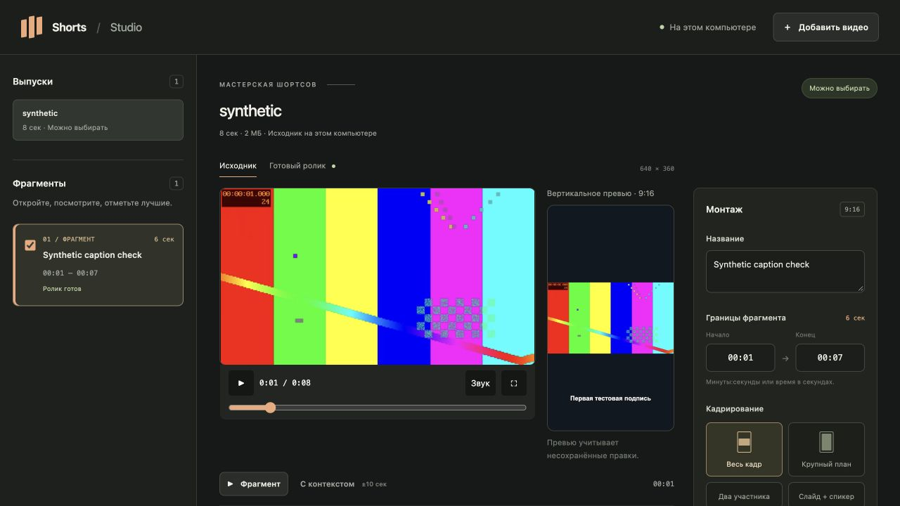

# Video Studio

Two local browser editors for talks, interviews, and podcasts: assemble a full episode from camera recordings, or turn a finished recording into captioned vertical clips. Both render with FFmpeg on your computer.

[Русская версия](README.ru.md) · [Setup](docs/setup.md) · [Podcast editing](docs/podcast-editing.md) · [Contributing](CONTRIBUTING.md)



Screenshot uses generated test media, not a real recording.

## Choose an editor

| Editor | Use it for | Launch | Extra requirements |
| --- | --- | --- | --- |
| Podcast montage | Manual cuts, reordered clips, camera changes, external WAV timing, full-episode MP4 | `./start-podcast.command /absolute/media/folder` | None beyond Node.js, FFmpeg, and ffprobe |
| Shorts | Transcript-based suggestions, portrait framing, corrected captions, MP4/SRT | `./start.command` | Codex login and a timed transcript or local Whisper |

The editors have **separate local URLs and projects**. Both interfaces currently use Russian. Podcast montage is offline after tool installation and requires no Codex account. Shorts sends transcript text to Codex for candidate selection. You can export an episode from montage and then import that MP4 into Shorts; project edits are not automatically shared.

## Shorts editor

- Reuse a timed transcript or transcribe locally with whisper.cpp.
- Ask Codex for complete, continuous ideas, then review their context before choosing clips.
- Adjust boundaries, titles, captions, and framing in a local browser UI.
- Fit the full frame, crop to portrait, stack two speakers, or combine a slide and speaker. Save reusable layout geometry.
- Export 1080×1920 H.264 MP4, burned-in captions, SRT, and an editable description. Source audio is retained when present.

Shorts are continuous ranges of 5–180 seconds. The selection prompt and default speech recognition currently target **Russian-language recordings**. The podcast editor provides a separate manual assembly workflow described below.

## Quick start on macOS

Install [mise](https://mise.jdx.dev/installing-mise.html) 2026.11.2 or newer. The repository pins Node.js 24.22.2 and FFmpeg 8.1.2, including ffprobe and subtitle support.

```sh
git clone https://github.com/polomodov/video-studio.git
cd video-studio
mise trust
./start.command
```

Open the local URL printed in the terminal. Keep that terminal open while editing; stop with Ctrl+C. No npm package installation is needed.

Both launchers use the pinned Node.js and FFmpeg when mise is available. **Shorts selection also needs an authenticated Codex CLI and either a timed transcript or local Whisper.** Podcast montage needs neither. Follow [setup](docs/setup.md) for the workflow you choose.

Apple Silicon macOS is the validated runtime. The lockfile also contains Intel macOS artifacts, but Intel execution has not been verified. Linux with manually installed tools is experimental; native Windows is unsupported.

## Assemble a podcast episode

```sh
./start-podcast.command /absolute/path/to/recording-folder
```

The folder can contain MP4/MOV/MKV/WebM camera files and external WAV audio. Open the printed URL, select a source, mark in/out points, and add it to the assembly. Split or remove ranges, reorder clips, and choose a different camera for each range. Set the corresponding WAV start time manually if using separate audio. Apply clip edits, save the project, preview junctions, then export a 1920×1080, 30 fps MP4.

There is no automatic synchronization or caption generation in this editor. Source files remain unchanged. See the [podcast guide](docs/podcast-editing.md) for saving, timing, storage, and preview limitations.

## Make a short

1. Click **Добавить видео** and enter the absolute path to a video on this computer. Import starts transcription and candidate selection.
2. Review each suggested clip, including context before and after it.
3. Edit its title, start/end times, captions, and layout. Save the changes.
4. Select the clips to export and click **Собрать выбранные**.
5. Watch each finished video, then download its MP4, SRT, and description.

If you already have a transcript, import it through the CLI **before starting the server**. This avoids unnecessary recognition. With mise on macOS, run from the clone:

```sh
mise exec -- node src/cli.mjs import \
  --source /absolute/path/recording.mp4 \
  --transcript /absolute/path/transcript.json
./start.command
```

Accepted formats and runtime overrides are documented in [setup](docs/setup.md). There is no transcript upload endpoint in the browser API yet.

## Where your data goes

Videos are read from their original paths and rendered locally. Shorts jobs, transcripts, layout templates, and exports live in `~/.cache/shorts-studio`, or the directory supplied with `--root`. Podcast projects and exports live in `.video-studio-montage` inside the selected recording folder; an existing `.apollo-montage` is reused when it is the only sidecar. Keep both kinds of working data outside Git, keep source files in place, and back up saved projects. The `~/.cache/shorts-studio` directory and `SHORTS_*` runtime overrides retain their existing names for compatibility.

**Codex receives the transcript text and recording title to suggest clips.** It uses your existing CLI login and account limits; no separate API key is required by Studio. The workflow is not fully offline. Installation can also download tools and model weights. Neither editor publishes to social networks.

## Work with an agent

The repository includes two portable skills: [`podcast-montage`](.agents/skills/podcast-montage/SKILL.md) for full episodes and [`video-shorts`](.agents/skills/video-shorts/SKILL.md) for captioned clips. Use them from this checkout or install their directories in your agent's supported skill location. Set `VIDEO_STUDIO_DIR` to the absolute clone path; both skills also accept `SHORTS_STUDIO_DIR` as a legacy alias. Skills do not include the application itself.

For example: “Use `$podcast-montage` to open this recording folder and prepare the camera cuts I marked,” or “Use `$video-shorts` to prepare clips from this video and transcript for me to choose.”

## Development and checks

The application uses Node.js built-ins and browser JavaScript. Python helpers use the standard library. See [CONTRIBUTING.md](CONTRIBUTING.md) for checks and [AGENTS.md](AGENTS.md) for coding-agent guidance.

```sh
mise exec -- npm test
mise exec -- npm run smoke
mise exec -- npm run smoke:podcast
```

The Shorts smoke check uses generated media and predetermined transcript/candidate data. The podcast smoke check exercises manual assembly with generated sources. These checks verify local export paths, not real speech recognition, Codex selection, or editorial quality. See the [workflow contract](docs/local-workflow.md) and [data model](docs/data-model.md) before changing persistence or the API.

## License

[MIT](LICENSE). External tools and model weights have their own terms; see [third-party notices](THIRD_PARTY_NOTICES.md).
