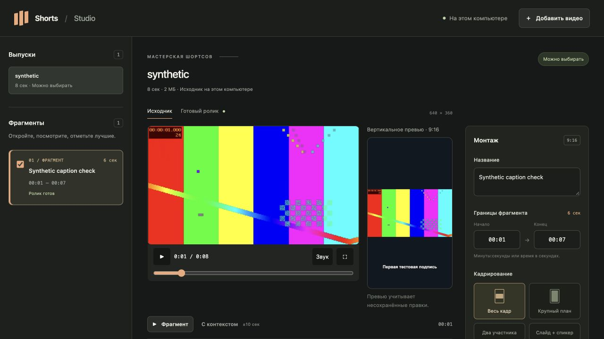

# Video Studio

Два локальных браузерных редактора для докладов, интервью и подкастов: сборка полного выпуска из камер и отдельный монтаж коротких вертикальных роликов с субтитрами. Оба собирают видео через FFmpeg на вашем компьютере.

[English](README.md) · [Установка](docs/setup.md) · [Монтаж подкаста](docs/podcast-editing.md) · [Участие в разработке](CONTRIBUTING.md)



На скриншоте синтетическое тестовое видео, а не запись выпуска.

## Выберите редактор

| Редактор | Для чего | Запуск | Дополнительные зависимости |
| --- | --- | --- | --- |
| Монтаж подкаста | Ручные склейки, удаление и перестановка фрагментов, смена камер, внешний WAV, полный MP4 | `./start-podcast.command /absolute/media/folder` | Только Node.js, FFmpeg и ffprobe |
| Shorts | Отбор по расшифровке, вертикальное кадрирование, правка субтитров, MP4/SRT | `./start.command` | Codex с авторизацией и расшифровка либо локальный Whisper |

У редакторов **отдельные локальные адреса и проекты**. Оба интерфейса пока на русском. Монтаж подкаста работает офлайн после установки инструментов и не требует Codex. Shorts передаёт текст расшифровки в Codex для отбора. Готовый выпуск можно экспортировать из монтажного редактора и импортировать в Shorts; монтажные решения между проектами автоматически не переносятся.

## Редактор Shorts

- Импорт готовой расшифровки с таймкодами или локальное распознавание через whisper.cpp.
- Отбор законченных мыслей с объяснением выбора и пометками о контексте.
- Правка границ, названия, субтитров и кадрирования в браузере.
- Полный кадр, вертикальный crop, два участника друг над другом или слайд со спикером. Геометрию можно сохранять в шаблоны.
- Экспорт MP4 1080×1920 с H.264, вшитыми субтитрами, отдельным SRT и описанием. При наличии исходного звука он сохраняется в AAC.

Shorts собирает непрерывные фрагменты длиной 5–180 секунд. Инструкция отбора и штатное распознавание рассчитаны на **русскоязычные записи**. Для ручной сборки длинного выпуска предусмотрен отдельный редактор ниже.

## Быстрый запуск на macOS

Установите [mise](https://mise.jdx.dev/installing-mise.html) версии 2026.11.2 или новее. В репозитории закреплены Node.js 24.22.2 и FFmpeg 8.1.2 с ffprobe и поддержкой субтитров.

```sh
git clone https://github.com/polomodov/video-studio.git
cd video-studio
mise trust
./start.command
```

Откройте адрес, напечатанный в терминале. Оставьте терминал открытым на время работы; остановка — Ctrl+C. Устанавливать npm-пакеты не нужно.

Оба лаунчера используют mise для установки закреплённых Node.js и FFmpeg. **Для отбора Shorts дополнительно нужны авторизованный Codex CLI и готовая расшифровка либо локальный Whisper.** Монтажному редактору они не нужны. Пройдите [установку](docs/setup.md) для выбранного рабочего процесса.

Запуск проверен на macOS с Apple Silicon. В lock-файле есть и сборки для Intel macOS, но выполнение на Intel не проверялось. Linux с ручной установкой инструментов — экспериментальный вариант. Нативная Windows не поддерживается.

## Собрать выпуск подкаста

```sh
./start-podcast.command /absolute/path/to/recording-folder
```

В папке могут находиться камерные MP4/MOV/MKV/WebM и отдельный WAV. Откройте напечатанный адрес, выберите видео, отметьте вход и выход и добавьте диапазон в сборку. Разрезайте и удаляйте фрагменты, меняйте их порядок и выбирайте камеру для каждого диапазона. Для внешнего звука вручную задайте соответствующий вход в WAV. Примените правки клипа, сохраните проект, проверьте стыки и экспортируйте MP4 1920×1080, 30 кадров/с.

Автоматической синхронизации и генерации субтитров в этом редакторе нет. Исходники не изменяются. Сохранение, таймкоды, хранение и ограничения превью описаны в [руководстве по монтажу](docs/podcast-editing.md).

## Сделать короткий ролик

1. Нажмите **Добавить видео** и укажите абсолютный путь к файлу на этом компьютере. Начнутся распознавание и отбор.
2. Посмотрите предложенные фрагменты и контекст до и после них.
3. Исправьте название, границы, субтитры и компоновку. Сохраните правки.
4. Отметьте нужные фрагменты и нажмите **Собрать выбранные**.
5. Просмотрите готовые ролики целиком и скачайте MP4, SRT и описание.

Если расшифровка уже есть, импортируйте её через CLI **до запуска сервера**, чтобы не запускать распознавание повторно. На macOS с mise выполните из каталога репозитория:

```sh
mise exec -- node src/cli.mjs import \
  --source /absolute/path/recording.mp4 \
  --transcript /absolute/path/transcript.json
./start.command
```

Поддерживаемые форматы и настройки путей описаны в [руководстве по установке](docs/setup.md). Загрузки отдельного транскрипта через браузерный API пока нет.

## Данные и приватность

Видео читается по исходным путям и собирается локально. Задания, расшифровки, шаблоны и результаты Shorts хранятся в `~/.cache/shorts-studio` либо в каталоге, заданном через `--root`. Проект подкаста и его MP4 находятся в `.video-studio-montage` внутри выбранной папки записи; существующая `.apollo-montage` переиспользуется, если это единственный такой каталог. Держите рабочие данные вне Git, не перемещайте исходники во время работы и сохраняйте резервные копии проектов. Каталог `~/.cache/shorts-studio` и переменные `SHORTS_*` сохраняют прежние имена для совместимости.

**Для отбора Codex получает текст расшифровки и название записи.** Используются существующий вход в CLI и лимиты вашей учётной записи, отдельный API-ключ Studio не нужен. Это не полностью офлайн-процесс. Установка также может скачивать инструменты и модель распознавания. Публикации в соцсети ни один из редакторов не выполняет.

## Работа с агентом

В репозитории есть два переносимых навыка: [`podcast-montage`](.agents/skills/podcast-montage/SKILL.md) для полного выпуска и [`video-shorts`](.agents/skills/video-shorts/SKILL.md) для шортсов. Используйте их в checkout либо установите каталоги туда, где ваш агент ищет навыки. Задайте `VIDEO_STUDIO_DIR` с абсолютным путём к клону; оба навыка также принимают прежнее имя `SHORTS_STUDIO_DIR`. Само приложение в каталоги навыков не входит.

Примеры запросов: «Используй `$podcast-montage`: открой папку записи и подготовь отмеченные мной смены камер» или «Используй `$video-shorts`: возьми видео и расшифровку, подготовь кандидатов и открой редактор для моего выбора».

## Разработка и проверки

Приложение использует встроенные модули Node.js и браузерный JavaScript, Python-скрипты — стандартную библиотеку. Правила участия находятся в [CONTRIBUTING.md](CONTRIBUTING.md), инструкции агентам — в [AGENTS.md](AGENTS.md).

```sh
mise exec -- npm test
mise exec -- npm run smoke
mise exec -- npm run smoke:podcast
```

Smoke-проверка Shorts использует сгенерированное видео и заранее заданные расшифровку и кандидатов. Проверка подкаста проверяет ручную сборку на сгенерированных исходниках. Это проверки локального экспорта, а не настоящего распознавания, отбора Codex или редакционного качества. Изменяя API и хранение, сверяйтесь с [контрактом](docs/local-workflow.md) и [моделью данных](docs/data-model.md).

## Лицензия

[MIT](LICENSE). Внешние инструменты и веса моделей распространяются на своих условиях; см. [уведомления о зависимостях](THIRD_PARTY_NOTICES.md).
