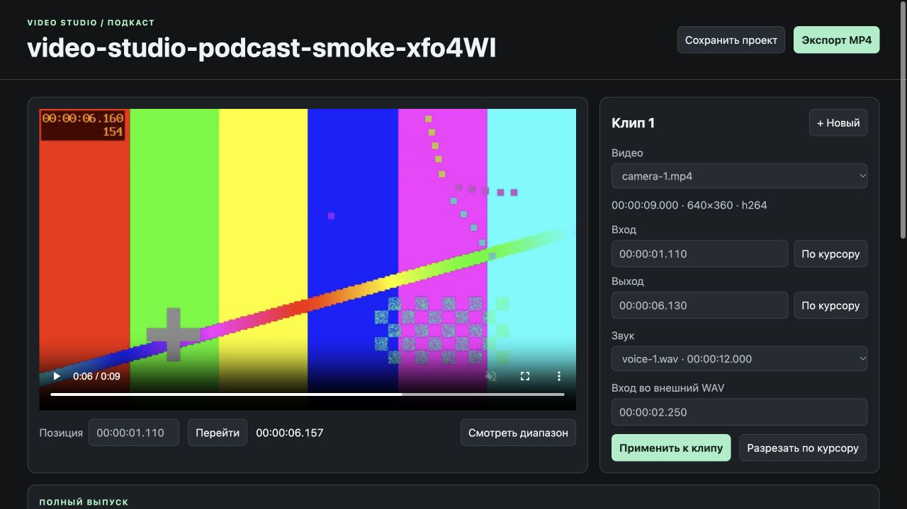

# Podcast montage



The podcast editor assembles a full episode from ordered video ranges. It supports manual cuts, removal and reordering of ranges, changing camera sources, and using a separate audio file. This is a separate editor from Shorts, with its own URL and project storage.

It needs Node.js 24+, FFmpeg, and ffprobe. **No transcript, Whisper installation, Codex account, or model call is needed.** After installing tools, editing and rendering work locally without network access. Both launchers share the repository's macOS mise setup and `SHORTS_FFMPEG`/`SHORTS_FFPROBE` executable overrides.

## Start with a recording folder

Place the recording folder outside the source checkout. It must be writable so the editor can save its project and renders beside the source files.

```sh
./start-podcast.command /absolute/path/to/recording-folder
```

The server scans the folder's top level for regular `.mp4`, `.mov`, `.mkv`, `.webm`, and `.wav` files. It does not recursively search subfolders or follow source symlinks. Use the actual local URL printed in the terminal; the server chooses an available port. Leave that terminal open. Stop with Ctrl+C after saving and finishing renders.

Without the launcher, in an already configured environment:

```sh
node podcast/server.mjs /absolute/path/to/recording-folder
```

The editor lists files FFprobe can inspect. That does not guarantee your browser can play each container/codec. A browser-compatible MP4 is the simplest starting point. Warnings identify unreadable sources and invalid saved projects; inspect them before replacing or saving anything.

## Build the episode

1. Select the source in **Видео** and inspect visible playback and audio.
2. Set **Вход** and **Выход**, either by typing a time or using **По курсору**. These are positions in that source file, not the finished episode.
3. Keep **Звук камеры**, or select a separate audio source and set its start time as described below.
4. Click **Добавить в сборку**. Existing ranges are edited through **Применить к клипу**.
5. Use **Разрезать по курсору** to split a selected clip, **Удалить** to remove a range, and arrows to reorder clips. To remove a pause inside a clip, split at both boundaries and delete the middle range.
6. Apply pending form edits, then click **Сохранить проект**. Saving the assembly and rendering a video are separate actions.

Changing cameras means choosing another source for the appropriate clip. There is no automatic alignment of camera recordings and no simultaneous multi-track timeline. If cameras started at different moments, calculate each camera's source time before making the switch. Check both sides of the junction.

The project accepts up to 2000 clips. Each range must stay inside its source and contain at least one output frame (1/30 second). Rendering rounds each range's duration to the 30 fps output grid. The assembly shows source positions and the resulting episode position separately.

## External WAV and synchronization

For an external recording, select it in **Звук**. **Вход во внешний WAV** is the position in that audio file corresponding to the video's **Вход**. It is an absolute audio time, not an offset to enter directly.

For example, if a visible event occurs at video time 12 seconds and audio time 14 seconds, a clip beginning at video time 30 seconds should start its audio at 32 seconds, assuming the recordings have no drift. Check several points across a long recording. A constant offset does not correct recorder clock drift.

The browser attempts playback synchronization for the selected range. Check lip sync or an identifiable transient, then render a junction preview to inspect the encoded result. A WAV decoding error in the browser does not establish that FFmpeg cannot use the file. Splitting a clip advances the right clip's audio start by the split distance; editing the video start manually requires reviewing its audio start too.

External audio must cover the entire selected range. Without an external selection, the camera's audio is used. If the camera has no audio, the renderer supplies silence. The editor has no waveform alignment, automatic synchronization, music mixing, loudness normalization, transcript generation, or caption generation.

## Save, preview, and export

**Сохранить проект** writes the current applied assembly to `project.json`. Unsaved edits live in the browser, and a navigation warning is not a backup. Apply form edits before saving or rendering. Export does not implicitly save the project.

**Стык →** renders up to the final four seconds of one clip and the first four seconds of the next, at **960×540**. It is a local technical preview, not a new full-episode export. Check picture continuity, timing, lip sync, clicks, and missing audio at each changed junction.

**Экспорт MP4** renders the full current assembly at **1920×1080, 30 fps**, H.264 video and stereo AAC audio at 48 kHz. Source frames fit inside 16:9 with padding, preserving their aspect ratio. Each completed output gets a new timestamped filename ending in `episode.mp4` or `junction.mp4`; source files are not overwritten. Intermediate render files require extra free disk space and are cleaned up after the attempt.

The full episode is offered for download. Watch the resulting file, not only the input monitor. Verify the full duration, order, edits, and synchronization before treating it as publication-ready. A few sampled frames or a successful synthetic render are narrower checks and must be reported as such. To make captioned vertical clips afterwards, import the completed episode MP4 into the separate Shorts editor.

## Project storage and recovery

New projects and renders live in `.video-studio-montage` inside the recording folder. When only the legacy `.apollo-montage` exists, the editor reuses it without moving or copying data. If both sidecars exist, startup fails rather than guessing which project is authoritative; stop existing editors, inspect/back up both, and explicitly choose the project to retain.

A single-writer lock protects the chosen project directory. Do not open two editing servers for the same recording folder, delete a live lock, or edit project JSON behind a running server. Separate recording folders can have separate servers. Save browser drafts before a restart and finish any render first.

A saved project is `{version:1,clips:[...]}`. Each clip stores `video`, `start`, `end`, `audio` (a source name or null), and `audioStart`. Sources are referenced by top-level filename. Keep filenames and media contents stable during editing; back up both recordings and the sidecar. The project does not contain copies of the source video. Unlike Shorts, this editor does not identify sources by content hashes.

The source list is discovered at startup. To add newly copied files, save the project and restart the server. Missing or renamed sources can make a saved clip invalid; restore the original files or repair the choices in the editor. Do not discard a saved project simply because its source folder is temporarily unavailable.

## Local API for agents

Prefer the UI for review and use the supported API for deterministic edits. Requests target the printed origin. POST requires `Origin` equal to that origin and `Content-Type: application/json`. A single job renders at a time.

| Request | Meaning |
| --- | --- |
| `GET /api/project` | Folder title, source metadata, warnings, saved clips, and project error |
| `POST /api/project` with `{clips}` | Validate and save the assembly atomically |
| `POST /api/render` with `{clips}` | Start a full export, return 202 |
| `POST /api/render` with `{clips,junction:index}` | Render the boundary after the zero-based clip index, return 202 |
| `GET /api/job` | Current render progress or result/error |
| `GET /media?name=...` | A discovered local source, supporting byte ranges |
| `GET /result?name=...` | A timestamped output; add `download=1` for download |

Rendering uses the submitted assembly and does not save it. A successful save does not create an export. Do not assume the server knows about an unapplied browser draft; preserve it before writing through the API.
